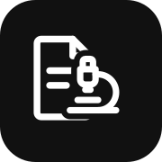
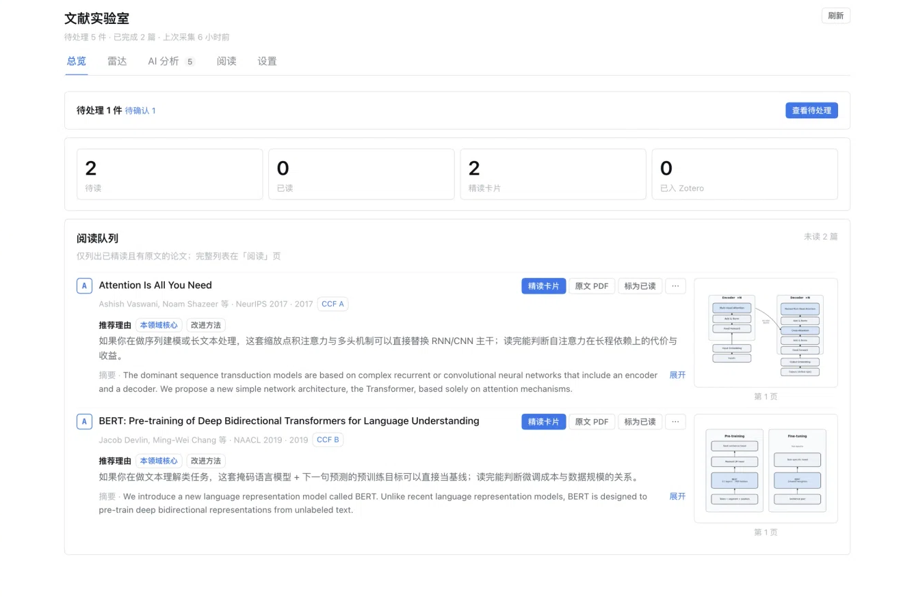
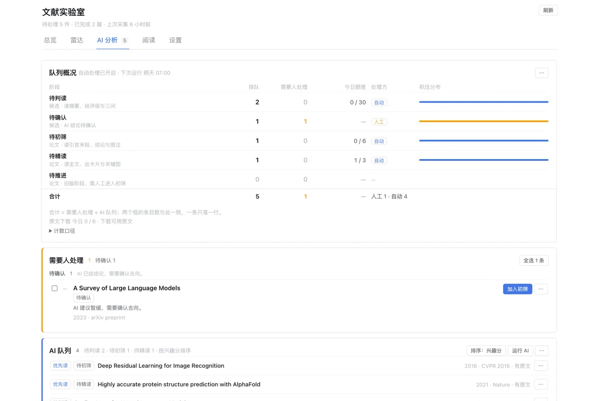
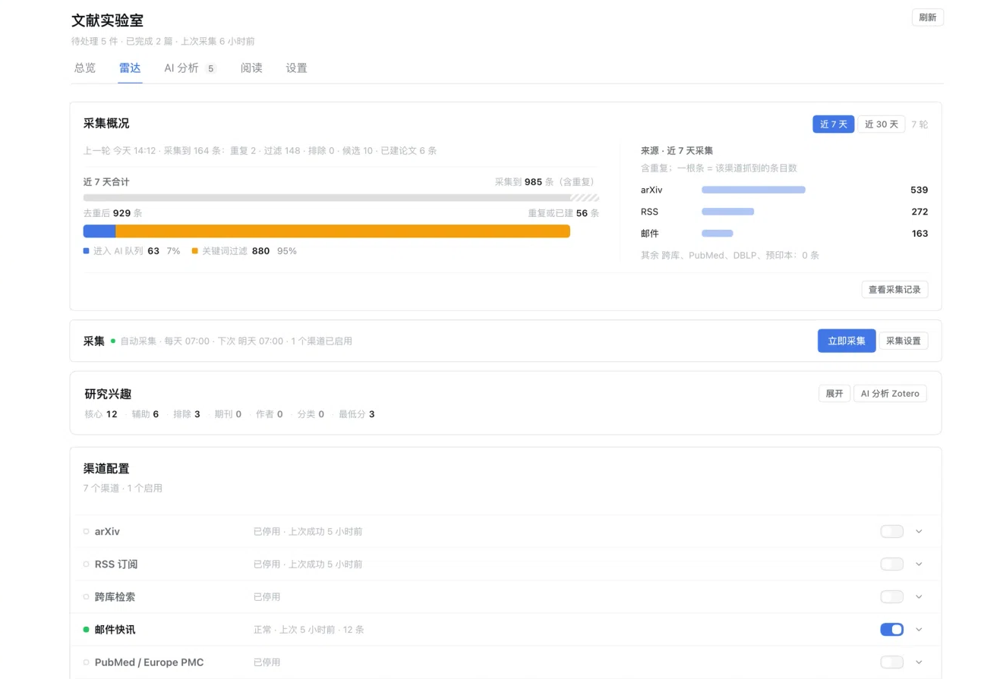
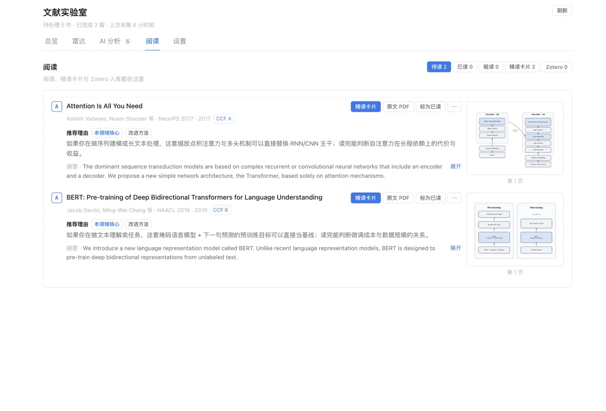
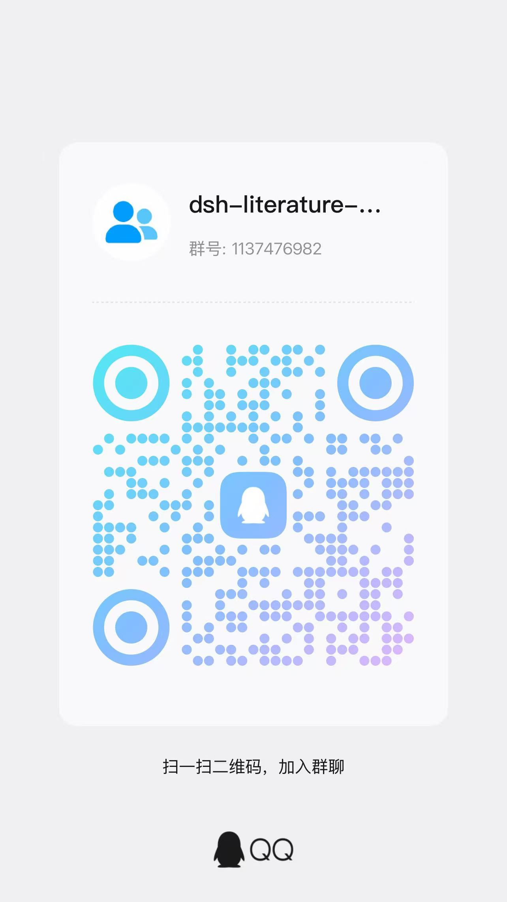

<p align="center">
  
</p>

<h1 align="center">文献实验室 · Literature Lab</h1>

<p align="center"><b>每天把几十条新文献压成两三条值得读的，并把「为什么值得读」写在旁边。</b></p>

<p align="center">DeepSeek Harness 插件 · 左侧栏入口「文献实验室」 · 交流群 QQ <b>1137476982</b></p>

<p align="center">
  <a href="#安装">安装</a> ·
  <a href="#一条流水线三个动作">流水线</a> ·
  <a href="#采集七个渠道一个面板">采集</a> ·
  <a href="#阅读卡片在前原文在侧">阅读</a> ·
  <a href="#等级怎么读">等级</a> ·
  <a href="docs/DETAIL.md">实现细节</a>
</p>



*总览：待处理事项、待读 / 已读 / 卡片 / Zotero 四个计数，下面是今天该读的那几篇。*

---

## 一条流水线，三个动作

| 步骤 | 做什么 | 产出 |
|---|---|---|
| **采集** | arXiv 分类、期刊 RSS、跨库检索、PubMed、预印本、邮件快讯；先按关键词去重过滤 | 候选池 |
| **判读** | 看摘要 → 初筛 → 精读，每层加成本、每层收窄 | 每篇一个等级，附判断理由 |
| **阅读** | 开放原文自动取回，精读产出卡片与关键图，达阈值入库 Zotero | 阅读队列与卡片 |

等级是结论不是打分：它回答「这篇对当前论文工作有没有用」，不看期刊名气。每层都给依据——同域性（核心 / 边缘 / 可迁移 / 无关）、具体增量、用途（改进方法 / 当基线 / 写作引用 / 了解现状），以及这一判是基于摘要、初筛还是全文。



*AI 分析：五个阶段各自的排队数、待人工处理量、今日额度与积压分布。*

## 采集：七个渠道，一个面板



*雷达：近 7 天采集概况（进入 AI 队列与关键词过滤的比例）、自动采集开关、研究兴趣、渠道健康。*

- **渠道**：arXiv、RSS 订阅、跨库检索、PubMed / Europe PMC、DBLP、bioRxiv / medRxiv、邮件快讯（Google 学术快讯）。
- **研究兴趣**：核心词、辅助词、排除词、期刊 / 作者 / 分类、最低分。也可以让 AI 读一遍 Zotero 库再总结关键词。
- **采集记录**：每轮抓了多少、哪条渠道失败、失败原因。

## 阅读：卡片在前，原文在侧



*阅读：待读 / 已读 / 粗读 / 卡片 / Zotero 分栏；每行带推荐理由、摘要与 AI 首选图。*

每行回答三件事：为什么值得读、这篇解决什么问题、图长什么样。点「精读卡片」是全文卡片（问题 / 方法 / 证据 / 局限 / 复现要点），点「原文 PDF」直接开读。

## 等级怎么读

| 等级 | 含义 |
|---|---|
| **S** | 直接命中核心问题且不可替代，会定义架构、关键实验或论文主张 |
| **A** | 直接对应核心问题，会改变模型 / 实验 / 硬件 / 论证，需要反复回看 |
| **B** | 高度相关，有可迁移的方法、基线或数据，能影响某项决策 |
| **C** | 背景、术语、局部方法、常见基线 |
| **D** | 全文比较后确认无信息增量，或核心主张存在影响用途的证据问题 |

等级在后两层可以改判，每次改判记下理由；人工改判优先于 AI，之后的自动运行不会覆盖。

## 三个判断层各做什么

| 层 | 需要什么 | 成本 | 产出 |
|---|---|---|---|
| **看摘要** | 一手摘要 | 每篇一次检索 | 同域性、具体增量、用途，初判等级 |
| **初筛** | 原文文本 | 读 2–3 页 | 精读 / 粗读 / 跳过 / 缺原文，并按当前证据重评等级 |
| **精读** | 全文 | 最重 | 最终等级、方法 / 证据 / 局限 / 复现要点、Markdown 卡片与 2–3 张关键图 |

摘要取不到时不硬判：记下原因，论文留在原地，等下一次或手动补 PDF。

## 安装

```bash
dsh plugin --profile desktop add dsh-literature-lab
```

把 `desktop` 换成实际 profile 名。装完**完全退出 DSH 再打开**，左侧栏出现「文献实验室」。

本地开发版：`dsh plugin --profile desktop add /path/to/dsh-literature-lab`。

## 第一次打开：配置检查

设置页顶部是一张配置检查表，四项齐全后流水线才会自己跑：

| 项 | 要求 |
|---|---|
| 研究兴趣 | 至少一个核心关键词，或让 AI 从 Zotero 库总结 |
| 渠道 | 至少启用一个来源 |
| Zotero 授权 + 自动入库 | 可选；入库前需要授权 |
| 模型 key | DSH 已有可用模型 |

## 五个页面

| 页面 | 回答什么 | 主要动作 |
|---|---|---|
| **总览** | 现在什么状况、今天读什么 | 看待处理、点进阅读队列、立即采集 |
| **雷达** | 从哪来、为什么漏了 | 调研究兴趣、开关渠道、立即采集、看采集记录 |
| **AI 分析** | 队列推进到哪、额度用在哪 | 运行判读 / 初筛 / 精读、改判、补 PDF、看积压 |
| **阅读** | 有什么可读、卡片与原文 | 读卡片、开原文 PDF、标已读 / 粗读、导出 Markdown |
| **设置** | 全局参数 | 判读额度与提示词、原文获取、Zotero 集成、系统参数 |

## 自动化与额度

- **自动采集**：雷达页「采集设置」里有开关与每天时间，到点只做采集。
- **采集后自动分析**：同一处的独立开关，**默认关闭**；打开后才按每日额度跑看摘要 / 初筛 / 精读。
- **立即采集**：只采集，不消耗 AI；结果进采集记录。
- **每日额度**（设置 → 判读）：默认看摘要 30 篇 / 初筛 6 篇 / 精读 3 篇 / 开放原文下载 6 篇；填 0 表示不做这一级。
- **抓取范围**（设置 → 抓取）：默认最近 48 小时。更早的内容不会被自动补抓，回溯用 agent 工具 `literature-lab_corpus` 的 harvest / snowball（不在界面里）。

## 和 agent 共用同一份状态

界面上的每个判断与操作都有对应的工具，也可以在对话里直接让 agent 做：

| 工具 | 作用 |
|---|---|
| `literature-lab_state` | 按层读论文；给 id 返回单篇完整记录 |
| `literature-lab_fetch_metadata` | 取一手摘要（DOI → OpenAlex / Crossref、arXiv、题名匹配） |
| `literature-lab_set_stage` | 推进层级、写三问与评级（必须写理由） |
| `literature-lab_download` | 取原文（开放获取 → 出版商模板 → 落地页 → 机构会话），失败分七类原因 |
| `literature-lab_search` / `literature-lab_ingest` | 检索并入队 / 手工清单并入队 |
| `literature-lab_corpus` | 回溯语料、候选、提升、邮件、原文、手动直通初筛 |
| `literature-lab_zotero` | Zotero 读取、关键词建议、入库 |
| `literature-lab_set_keywords` | 写入研究兴趣关键词 |
| `literature-lab_discover` | 触发一轮采集 |

典型用法：让 agent「把今天判为 A 的读一遍，给我研究卡片」——它读的是同一份状态，界面会同步更新。

## 数据与隐私

- 论文状态、配置、原文、关键图都在**本机插件目录**：`state/`（JSON 与 figures）、`pdfs/`（PDF）。
- Zotero 的 API key 存在 DSH 自己的凭据服务里，不写日志、不出现在工具返回里。
- 插件不登录、不导出 Cookie，只取公开元数据（arXiv / OpenAlex / Crossref 等）。
- 浏览器扩展只用当前已登录的 Chrome 会话，不读取也不上传 Cookie。
- 本机 PDF bridge 只绑 `127.0.0.1`，导入请求必须带 `x-dsh-token`（插件 `state/config.json` 的 `bridge.token`）。

## 浏览器扩展（可选，用来抓出版社 PDF）

`extension/` 是一个本地 Chrome 扩展，在已授权的浏览器会话里把出版社 PDF 抓下来：

1. 打开 `chrome://extensions`，开启开发者模式；
2. 「加载已解压的扩展程序」，选择本仓库的 `extension/`；
3. 扩展选项里填「bridge token」，取值是插件 `state/config.json` 的 `bridge.token`；
4. 在文章页点扩展图标，PDF 与 `.json` 侧车落到 `~/Downloads/论文/`，扩展带 `x-dsh-token` 调本机 bridge；
5. 插件同时监听该目录作为兜底。

不支持自动下载的出版社（如部分 IEEE 页面），这是最省事的一条路。

## 机构访问（可选）

设置 → 原文 → 机构访问。填三项就能用：**方式**（EZproxy / WebVPN / CARSI）、**学校给的登录格式**、**机构域名**，
再把浏览器里已登录的 Cookie 粘进「会话 Cookie」保存。右下角「自检」可以当场拿一个文章页试一次，
直接告诉你「能取到 PDF」还是「需要登录 / 被拦截 / 打开的是落地页」，不用等下载失败才知道。

Cookie 存在本机凭据服务里，设置页只显示「已保存 / 未保存」，读不回来；要清空就留空保存。

对应的配置长这样（设置页写的就是这些字段）：

```json
{
  "download": {
    "access": {
      "mode": "ezproxy",
      "ezproxy": { "template": "https://ezproxy.yourschool.edu/login?url={url}" },
      "institutionalHosts": ["sciencedirect.com", "ieeexplore.ieee.org"],
      "browserSession": { "userAgent": "", "cookieSecret": "DSH_LITERATURE_LAB_INSTITUTIONAL_COOKIE" }
    }
  }
}
```

- `mode` 三选一：`ezproxy` 按模板改写并编码；`webvpn` 用你自己的正则改写
  （`webvpn.pattern` / `webvpn.replacement`，各校规则不同，不硬编码）；`direct` 只在
  `institutionalHosts` 上附带 Cookie（CARSI / Shibboleth 登录之后就是这样用）。
- Cookie 存在本机凭据里（`DSH_LITERATURE_LAB_INSTITUTIONAL_COOKIE`），**不写进 config、不进仓库**；
  Cookie 只会发给 `institutionalHosts` 或改写后命中的机构域名，不会发给无关站点。
- 取不到时先看失败原因：`paywalled` 说明会话没生效或没订阅、`blocked` 说明被反爬拦了、
  `not-pdf` 说明打开的是落地页。每条原因都带一句下一步。

## 已知限制

- **翻译不在插件内**：翻译走单独的 PDF 翻译流程。
- **出版社 PDF**：自动链路覆盖开放获取、出版商官方模板、落地页发现与可选的机构会话；被反爬拦住的页面用浏览器扩展或手动下载。
- **Zotero 撤销入库**：暂未实现，入库后要在 Zotero 里操作。
- **列表分页而非虚拟滚动**：候选 20 条/页，论文分批加载。

## 交流

QQ 群 **1137476982**。装不上、判读结果不对、想加渠道，群里直接说；版本更新也在群里通知。

<p align="center"></p>

## 开发

- 客户端源码在 `client/src/*.js`，由 `scripts/build-client.mjs` 拼成单文件 `client.js`：

  ```bash
  npm run build:client   # 改完 client/src 后必须执行
  npm test               # 渲染冒烟 + 静态约定 + 构建一致性
  ```

- 直接改 `client.js` 会在下次构建时被覆盖。
- 插件 bundle 不热重载：改完要**完全退出 DSH 再打开**。
- `index.js` 是组合根；handler 在 `lib/http/handlers.js`，agent 工具在 `lib/tools.js`，状态读写经 `lib/repo/` 与 `lib/store.js`。
- 数据对账：`node scripts/data-doctor.mjs`（只读；`--strict` 时 error 退出 1）。
- 内部实现（去重、过滤、渠道细节、状态机、数据结构）见 [docs/DETAIL.md](docs/DETAIL.md)，文档索引见 [docs/README.md](docs/README.md)。

## License

MIT
